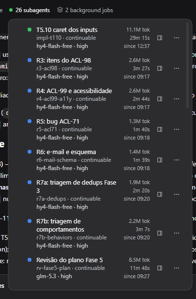
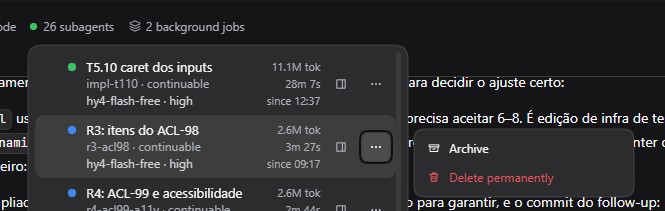
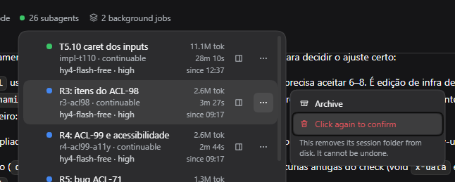
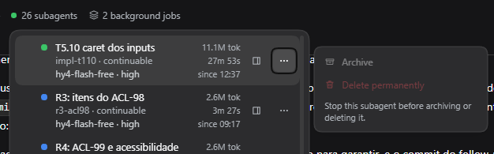
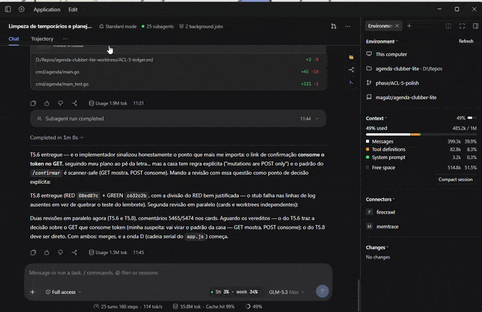

# dsh-subagent-panel-plus

A DeepSeek Harness (DSH) bundle that replaces the session header's native subagent list with a copy that identifies each subagent by model, orders it by state and can archive or permanently delete it.

The native chip is shadowed, not removed: uninstalling the bundle brings it back.

## How it looks



Each row's `⋯` menu offers Archive and Delete permanently:



The first click arms the delete for four seconds; the second click confirms it:



While the subagent runs, both actions stay disabled:



The whole flow — opening the panel, opening a subagent in the right sidebar and full screen, archiving and deleting from the row menu:



## What it shows

- **Model and reasoning effort** on a third line of each row (`model · effort`), from DSH's model-selection projection; `—` when no selection has been recorded.
- **State order**: running first, then idle, then done, then external. Catalog order is stable inside each group.
- **A status dot**: green running, yellow idle (not running and last turn not completed), blue finished, grey external.
- **Metrics**: total tokens, active working time and `since HH:MM`. DSH stores no end-of-turn time, so `since` is the subagent's spawn time.
- **Navigation**: click a row to open the subagent; the sidebar button opens it in the right sidebar. ArrowDown on the chip opens the list and focuses the first row; Up/Down/Home/End move; Right/Left expand and collapse; Enter or Space opens; Escape closes and returns focus to the chip.
- **A more-actions menu** (`⋯`) on each row, placed beside the list when there is room and inside it otherwise. It opens in a list positioned outside the subagent panel when space allows:
  - **Archive** — DSH's own reversible archive, disabled while the subagent runs. Archived rows leave the list.
  - **Delete permanently** — two clicks (the first arms the action for four seconds), disabled while the subagent runs. After all checks pass, the Host archives the session and removes its session folder and the folders of its own subagents. It cannot be undone.

## Safety model

DSH has no permanent delete for sessions, so the Host half removes `<sessions root>/<project>/<id>/` itself. It refuses when the id is not a listed subagent, when the target or a descendant is running, when the target is not a subagent origin, or when the folder has no session log. The root is `<DSH_HOME or ~/.dsh>/sessions`. Folders reached through a link are never followed.

Both Host routes go through DSH's own Connection gate, so another web page cannot call them; the gate and the workspace registry failing closed means no delete happens. A companion `exists` route lets the list hide sessions whose folder is gone, whoever removed it. It never hides a running or loaded session and reports nothing when the disk read is incomplete, so a deleted subagent stays gone in every browser.

DSH's search index, projection cache and archived-session set still hold the record of a deleted session, and its parent's log still names it. It can appear as an empty entry in other session lists. A deletion is permanent on disk and cannot be undone.

## Known gaps

- The agent-team task board is not shown, and with tasks but no subagents the chip does not appear at all; only the native entry can declare the footer slot that renders the board.
- No retry button after a failed catalog load, and no migration-required handling in the tree.
- Hover opens the list even when a narrow header hides the count. Archive shows no undo notice.
- The breadcrumb switcher inside a subagent session remains native.
- The icon and menu placement were verified by source review, Node tests and live-browser screenshots (see How it looks); keyboard use was tested personally by the owner.

## Install

In dsh, open **Plugins → Add plugin** and enter `github:magalz/dsh-subagent-panel-plus`; restart DSH if the panel does not appear. The package is a plain ESM bundle with no build step and no runtime dependencies, so a git install needs no `allowBuilds` permission.

The same dialog also accepts the prebuilt tarball attached to [release v0.1.0](https://github.com/magalz/dsh-subagent-panel-plus/releases/tag/v0.1.0), or a local path to a checkout of this repository:

```shell
dsh plugin --profile <name> add ./dsh-subagent-panel-plus
```

The [community readiness review](https://github.com/magalz/dsh-subagent-panel-plus/blob/main/docs/community-readiness.md) tracks the remaining open items.

## Layout

| Path | Role |
|---|---|
| `host.js` | Host half: authenticated `delete` and `exists` routes. |
| `client.js` | Browser half: header chip, tree, keyboard navigation and row actions. |
| `cordis.patch.yml` | Bundle patch inserting the plugin row. |
| `locale/en.json` | Plugin Manager title and description. |
| `icon.svg` | Plugin icon. |
| `test/` | 37 Node tests for both halves. |
| `docs/screenshots/` | Live-browser screenshots used by this README and the plugin market. |

## Develop

```sh
npm run check   # syntax check of both JavaScript halves
npm test        # node --test over test/*.test.mjs
```

Both commands pass at release `v0.1.0`.

## Documents

- [Specification](docs/SPEC.md) — goal, scope, acceptance criteria, failure modes, priorities and non-goals.
- [Architecture decision records](docs/adr/) — why the bundle shadows the native entry, deletes from the Host and stays build-free.
- [Business rules](docs/bdr/) — listing, deletion and synchronization rules.
- [Community readiness](docs/community-readiness.md) — checks passed and open items before publication.

All content in this repository — code comments, labels, metadata, tests and documentation — is in English.
